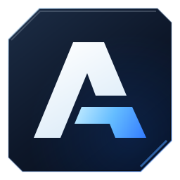

<p align="center"></p>

# Azrak Launcher

A console-style home screen for Linux. Browse PS5, PS4 and PC games with their official artwork, download
and install them, and play them with the [KytyPS5](https://github.com/KytyPS5/KytyPS5) (PS5) and
[shadPS4](https://github.com/shadps4-emu/shadPS4) (PS4) emulators, using a controller, keyboard or
mouse.


- **Your games on a console-style Home screen**, with official backgrounds, logos and trailers that
  play right in the launcher.
- **A Library of 400+ PS5 games** with search, genre filters and sorting. New releases show up
  by themselves: the list is updated daily.
- **PS4 games too:** they run on shadPS4, which the launcher installs and updates by itself, like KytyPS5.
- **And PC games:** native Linux games, and Windows games packed to run with Wine, with Steam
  artwork and ProtonDB ratings.
- **See what runs:** every game shows how far it gets in its emulator.
- **Download, install and play** without leaving the launcher, through your own VPN if you like.
- **Keeps itself and KytyPS5 up to date**, without touching your saves.

## Install

You need 64-bit Linux: Ubuntu 22.04+, Debian 12+, Fedora 36+, Mint 21+, Arch or SteamOS 3.
Open a terminal and run:

```bash
curl -fsSL https://github.com/AzrakHQ/azrak-launcher/releases/latest/download/azrak-linux-x86_64.tar.gz | tar xz && ./azrak-linux-x86_64/install.sh
```

**Azrak Launcher** is now in your app menu. For trailers, switching between a game and the
launcher, and installing from archives, also run (Ubuntu, Debian, Mint):

```bash
sudo apt install xdotool mpv libarchive13
```

To uninstall: `./azrak-linux-x86_64/install.sh --uninstall`

## Or turn a spare PC into a console

**AzrakOS** makes a PC start straight into the launcher, like a console: no desktop, set up
with a controller, and the launcher, its emulators and the system keep themselves up to date.
It's built in [AzrakHQ/azrak-os](https://github.com/AzrakHQ/azrak-os).

1. Download [AzrakOS](https://github.com/AzrakHQ/azrak-os/releases/latest/download/azrak-os-x86_64.iso)
   (1.8 GB) and put it on a USB stick of 4 GB or more with [balenaEtcher](https://etcher.balena.io).
2. Start the PC from the USB stick (press F12, F11, F8 or Esc while it starts). AzrakOS starts
   from the stick, and nothing on the PC changes.
3. Choose **Try AzrakOS**, or **Install on this PC**: pick the disk (it's erased), and restart.

What the PC needs, and help with the install, is in
[AzrakOS's README](https://github.com/AzrakHQ/azrak-os#readme).

## Getting started

1. Open **Azrak Launcher** from your app menu, or run this in a terminal:

   ```bash
   azrak
   ```

   The first launch downloads artwork and KytyPS5, which takes about a minute.
2. Already have games? Add their folder in **Settings → Game folders**.
3. To get a game, open it in the **Library**, choose **Download**, then **Install**, then
   **Play**. Keep the launcher open while it downloads.

> Only download games you own. Downloads use BitTorrent: other people can see your IP address,
> and finished downloads are shared while the launcher is open (turn this off in
> **Settings → Keep sharing finished downloads**).

**Hide your IP address with a VPN.** Turn on **Settings → Download only through a VPN**.
Downloads then use only your VPN: if it disconnects, they pause and carry on when it's back,
so your real address is never used. Bring your own VPN (WireGuard or OpenVPN): connect it with
its app, or choose **Settings → Your VPN** and pick the `.conf` or `.ovpn` file from your
provider's website.

## Controls

| Action | Controller | Keyboard |
|---|---|---|
| Move / Select / Back | D-pad, ✕, ○ | Arrows, Enter, Esc |
| Options for a game | Options | O |
| Search | △ | / |
| Switch Home ⇄ Library | L1 / R1 | Tab |
| Switch between game and launcher | PS button | |
| Downloads | | Ctrl+D |

**Games play best with a controller.** DualSense, DualShock 4, Xbox and most other controllers
work in games over USB or Bluetooth with no setup; connect yours before starting a game. Without
one, games use the keyboard: **J I K L** for ✕ △ □ ○, **W A S D** to move, **arrow keys** for the
D-pad and **Enter** for Options (PS4 games use **N C V B** for ✕ △ □ ○). See **Settings → Keyboard
controls in games** for every key.

## Will my game run?

Each game shows a tag from its emulator's community list ([KytyPS5](https://kytyps5.github.io/) for
PS5, [shadPS4](https://github.com/shadps4-compatibility/shadps4-game-compatibility) for PS4):
🟢 **Playable**, 🟡 **Menus only**, 🟠 **Logos only** (intro logos, then it stops), 🔴 **Doesn't start**,
or ⚪ **Untested**.

Only Linux results count, since the launcher runs on Linux: covers and the Library's **Playable**
filter show what's been confirmed there. A game tested only on Windows counts as untested here,
because games can behave differently on Linux.

**Will it run on my PC?** Each Game Hub sums it up in one line: **Plays on this PC**, **Starts,
but may stop early**, **Doesn't start yet** or **Not tested yet**, with the results behind it
(Linux, Windows, this PC) in smaller text underneath. It also says when your PC can't run the
emulator (**Doesn't start on this PC**, e.g. a graphics card without Vulkan 1.3) or may run it
slowly (e.g. integrated graphics). Under **Download** you see the size, the folder it goes to,
and a warning when there isn't room. The launcher checks your processor, memory and graphics
card when it starts; see them in **Settings → This PC**. PS4 games need a processor from 2013 or
later (with AVX2).

**Help others:** when you close a game, the launcher asks how far it got, and your answer
becomes its tag on your PC. Every so often, choose **Settings → Share your game ratings** to send
your results to the community lists (needs a free GitHub account).

PS4 releases shipped as **PKG packages** install like any other: the launcher unpacks the game,
its update and its DLC for shadPS4 (it fetches a small PKG extractor the first time, and needs
Linux 5.13 or newer). PS5 PKG
releases can't be installed; pick a release that is a folder, an archive or an exFAT image.

## PC games

The Library also lists RuTracker's Linux games: native ones, and Windows games packed to run with
Wine (choose **PC games only** to see just those). They show Steam's artwork and description,
and Wine-packed games show their [ProtonDB](https://www.protondb.com/) rating, which says how
well the Windows version runs on Linux.

**Install** unpacks the game, whether it's a folder, an archive, a GOG installer (`.sh`) or an
AppImage, and finds how to start it: the uploader's start script, the game's program or its
AppImage. **Play** starts it. If it starts the wrong thing, choose **Options → Start with …** to
try the next one.

- **Wine-packed games** include their own Wine but need its system libraries: install Wine from
  your distribution once (`sudo apt install wine` on Ubuntu, Debian and Mint).
- **Windows games without a start script** run through
  [umu-launcher](https://github.com/Open-Wine-Components/umu-launcher) (Proton) if it's
  installed, otherwise through Wine.
- **Unlike console games**, which run inside an emulator, PC games run with your user's access
  to your files. Only install releases you trust.

## Help

- **A game closes right away:** check its tag, then **Options → View emulator log**.
- **Resume or Stop doesn't work:** install `xdotool`.
- **Wrong screen:** change **Settings → Display**. For a window, run `azrak --windowed`.
- **Too big or too small:** run `AZRAK_SCALE=1.15 azrak` (bigger number, bigger UI).
- **A new KytyPS5 broke a game:** **Settings → Roll back to previous KytyPS5**.

Still stuck? [Open an issue](https://github.com/AzrakHQ/azrak-launcher/issues).
Developers: see the [developer guide](docs/DEVELOPMENT.md).

---

Azrak Launcher is an unofficial fan project, not affiliated with or endorsed by Sony Interactive
Entertainment. "PlayStation" and "PS5" are trademarks of Sony Interactive Entertainment. Game
artwork and information belong to their owners. Use only games you own.

<a href="https://slint.dev"></a>
